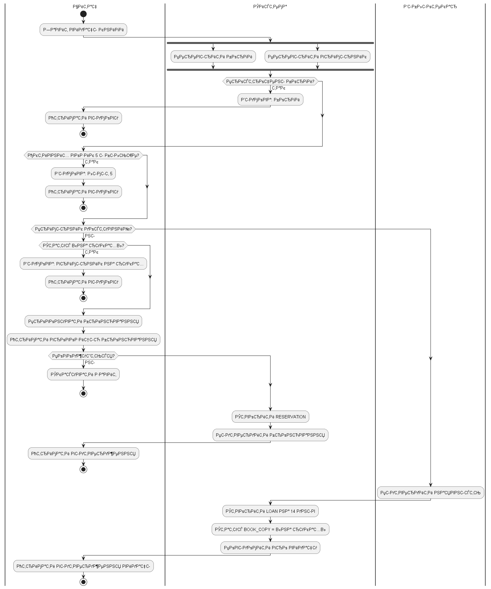
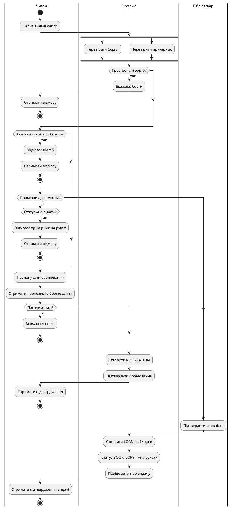

# Діаграма діяльності: Видача книги (Завдання 4)

Діаграма описує процес видачі книги читачеві. Показано перевірки боргів, ліміту позик і доступності примірника.

## activity-borrow

Код PlantUML

