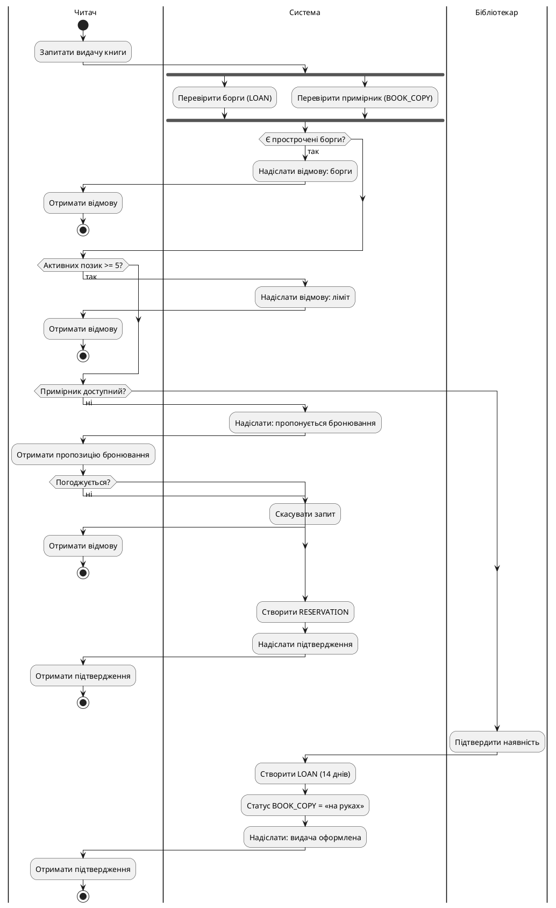

# Завдання 4: Бізнес-процес (Activity Diagram)

Мета: описати UC_Borrow як єдиний бізнес-процес з усіма сценаріями на одній діаграмі діяльності.

## Діаграма

Код PlantUML

## Сценарії і шляхи

| Сценарій | Шлях (коротко) |
| :--- | :--- |
| S1 Успішна видача | паралельно: борги (ні) & примірник (так) → підтвердити → створити LOAN → кінець |
| S2 Бронювання | паралельно: борги (ні) & примірник (ні) → пропозиція → погоджується (так) → створити RESERVATION → кінець |
| S2a Відмова бронювання | паралельно: борги (ні) & примірник (ні) → пропозиція → погоджується (ні) → скасувати → відмова → кінець |
| S3 Відмова через борги | борги (так) → відмовити → кінець |
| S4 Відмова через ліміт | борги (ні) → ліміт (≥5) → відмовити → кінець |

## Учасники і сутності

Смуги: Читач, Система, Бібліотекар. Вузли даних: MEMBER, LIBRARIAN, BOOK_COPY, LOAN, RESERVATION. Паралельні перевірки боргів (LOAN) і примірника (BOOK_COPY), ранні виходи для відмов.

## Як переглянути

Відкрити activity.png або activity.puml у PlantUML.